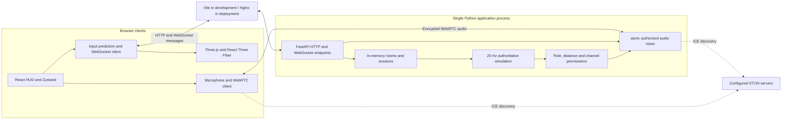
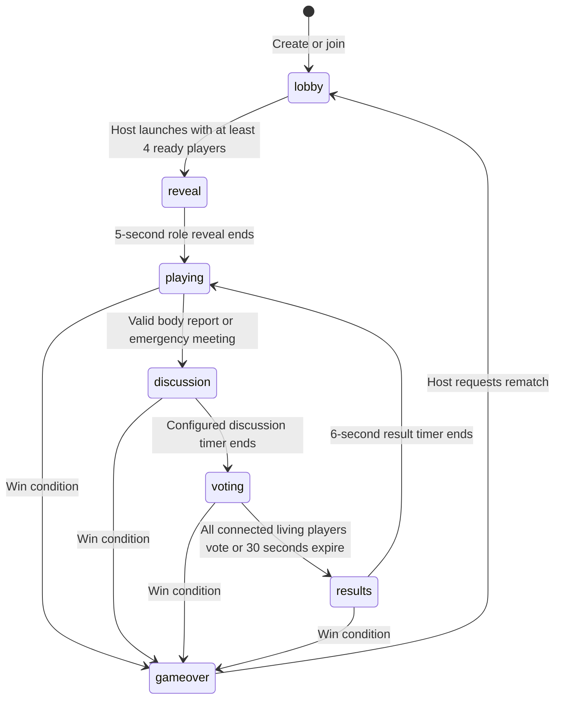
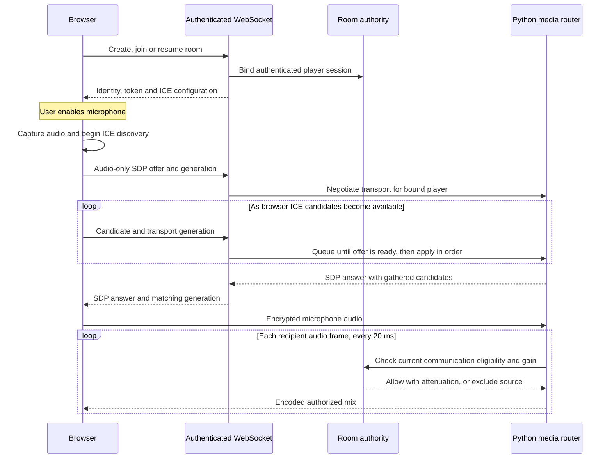

# WhoSus?

WhoSus? is a browser-based 3D social deduction game for **4-12 players**, set on Cloudline Station. Crewmates maintain the station and investigate; impostors sabotage it and eliminate crew. A FastAPI server owns the match, while a React Three Fiber client renders the world and handles player input.

This README is the single project guide for setup, architecture, local testing, and deployment. The frontend and backend have separate dependencies and build contexts.

**Verification status:** all **34 backend tests** pass locally. The dedicated **five-browser voice suite** uses synthetic microphones and checks real decoded audio, permission/playback recovery, push-to-talk, reconnects and ghost isolation. Full game-UI validation is tracked separately below. Physical Android and internet NAT traversal testing are still outstanding.

## Contents

- [Repository layout](#repository-layout)
- [Local setup](#local-setup)
- [Play and controls](#play-and-controls)
- [Architecture](#architecture)
- [Communication permissions](#communication-permissions)
- [Local testing](#local-testing)
- [Configuration](#configuration)
- [Docker and deployment](#docker-and-deployment)
- [Troubleshooting](#troubleshooting)
- [Original 3D assets](#original-3d-assets)

## Repository layout

```text
whosus/
|-- README.md                         Project documentation
|-- whosus_backend/
|   |-- app/
|   |   |-- app.py                    Local backend runner
|   |   |-- main.py                   FastAPI setup and simulation loop
|   |   |-- config.py                 Pydantic settings and shared app state
|   |   |-- models.py                 Validated WebSocket message schemas
|   |   |-- connection.py             WebSocket send queue
|   |   |-- routes/
|   |   |   |-- api.py                Health and public-room endpoints
|   |   |   `-- websocket.py          WebSocket game and voice signaling
|   |   |-- game.py                   Authoritative rules and communication policy
|   |   `-- voice.py                  WebRTC transport and authorized audio mixes
|   |-- tests/
|   |   |-- test_game.py              Rules, input validation, channel permissions
|   |   |-- test_network.py           WebSocket clients and session recovery
|   |   `-- test_webrtc.py            Real media transport and audio revocation
|   |   `-- test_voice_signaling.py   Candidate queues, generation checks, origins
|   |-- .env.example                  Backend configuration template
|   |-- .gitignore
|   |-- Dockerfile
|   |-- pytest.ini
|   `-- requirements.txt
`-- whosus_frontend/
    |-- src/
    |   |-- App.tsx                   Menu, lobby, HUD, tasks, meetings, touch controls
    |   |-- Scene.tsx                 Station, GLB characters, camera, interpolation
    |   |-- network.ts                WebSockets, prediction, reconciliation
    |   |-- voice.ts                  Microphone, WebRTC, playback, mute/PTT/deafen
    |   |-- store.ts                  Zustand client state
    |   |-- world.ts                  Client collision geometry
    |   `-- audio.ts                  Synthesized interaction sounds
    |-- public/models/                Exported GLBs and editable Blender source
    |-- assets/build_assets.py        Original model generator
    |-- test/browser-test.mjs         Browser integration checks
    |-- test/voice-test.mjs           Five-browser media and permission checks
    |-- test/wait.mjs                 Promise-aware test polling
    |-- test/diagnose.mjs             Additional browser diagnostics
    |-- nginx.conf                   Frontend-owned Nginx runtime template
    |-- .env.example                 Docker runtime configuration example
    |-- .gitignore
    |-- Dockerfile
    |-- package.json
    |-- package-lock.json
    `-- vite.config.ts
```

Generated files stay inside their application: Python packages in `whosus_backend/.venv/`, npm packages in `whosus_frontend/node_modules/`, frontend builds in `whosus_frontend/dist/`, and browser evidence in `whosus_frontend/artifacts/`. Each application ignores its generated files and local secrets.

## Local setup

### Prerequisites

| Dependency | Required for |
| --- | --- |
| Node.js 22+ and npm | Frontend development, production builds, browser tests |
| Python 3.11-3.13 with pip and venv | Backend and Python tests |
| A current WebGL-capable browser | Rendering and gameplay |
| Microphone permission and headphones | Manual voice testing |
| Chromium installed through Playwright or `WHOSUS_BROWSER` | Automated browser tests |
| Blender, optional | Regenerating the supplied 3D assets |
| Docker, optional | Building and running deployment images |

The examples below use Windows PowerShell. Start each terminal at the repository root. Use `npm.cmd` to avoid PowerShell restrictions on `npm.ps1`. If `python` resolves to an unavailable Microsoft Store alias, use your installed interpreter, for example `py -3.13 -m venv .venv`.

### Terminal 1: backend

```powershell
cd whosus_backend
python -m venv .venv
.venv/Scripts/python.exe -m pip install -r requirements.txt
if (-not (Test-Path -LiteralPath .env)) { Copy-Item -LiteralPath .env.example -Destination .env }
.venv/Scripts/python.exe -m app.app
```

Keep this terminal running. The backend should report that application startup completed and that it is listening on port **8000**. Python environments are machine-specific; create a fresh one when setting up another computer.

### Terminal 2: frontend

```powershell
cd whosus_frontend
npm.cmd ci
npm.cmd run dev -- --host 127.0.0.1 --port 5173 --strictPort
```

Keep this terminal running and open **http://127.0.0.1:5173**. The strict port setting prevents Vite from silently selecting another port that the backend or browser tests do not expect. When `VITE_BACKEND_ORIGIN` is unset, Vite forwards `/api` and `/ws` to `127.0.0.1:8000`. To use a direct backend origin in development, set `VITE_BACKEND_ORIGIN` in the frontend environment; the backend must allow the frontend origin in `ALLOWED_ORIGINS`.

### Terminal 3: readiness checks

```powershell
Invoke-RestMethod http://127.0.0.1:8000/api/health
Invoke-RestMethod http://127.0.0.1:5173/api/health
```

Both requests should return `ok: true` and `game: WhoSus?`. The second request checks the local Vite proxy. `/api/rooms` returns discoverable public lobbies; an empty list is valid when no public room exists.

On macOS/Linux, use `python3`, `.venv/bin/python`, and `npm` instead of the Windows command names. Create the backend `.env` with `cp .env.example .env` on first setup, then use the same uvicorn arguments. The application does not require a database or an account for local play.

## Play and controls

Create a private or public room, then join it from **at least four independent browser contexts or devices**. Use distinct browser profiles or different browsers; ordinary duplicated tabs may copy the same session token and reconnect as the same player. Everyone must be connected and ready before the host can launch. Enable voice with the microphone button in each participating client.

Crewmates win by completing every assigned task or ejecting all impostors. Impostors win when living impostors reach parity with living crew, or when a reactor sabotage expires. Ghosts can continue tasks. A vote tie or a winning skip vote ejects nobody. After game over, the host can return the room to the lobby for a rematch.

| Action | Desktop | Touch |
| --- | --- | --- |
| Movement | WASD | Virtual joystick |
| Task, meeting beacon, reactor repair | E | Interact |
| Report a nearby body | R | Report |
| Station overview | Tab | Map icon |
| Toggle microphone | M | Microphone icon |
| Push-to-talk | Hold V | Hold voice button |
| Deafen | Headphones button | Headphones button |
| Open text chat | Enter | Chat icon |
| Eliminate nearby crew | F | Eliminate |
| Enter or exit a service duct | Q | Service duct / Exit duct |
| Move between ducts | Next duct button | Next duct button |

## Architecture

### Components and trust boundaries



The server trusts session identity established on the WebSocket, rather than a player ID supplied with each action. It assigns roles, validates actions, advances time, and creates a separate snapshot for each player. Clients submit movement inputs, task steps, action requests, votes, and chat messages; they cannot authoritatively set positions, roles, cooldowns, or outcomes.

| Responsibility | Implementation |
| --- | --- |
| Room creation, joining and public discovery | `app/main.py`; six-character codes; `/api/rooms` lists eligible public lobbies |
| Simulation | `app/game.py`; fixed 50 ms steps, bounded input queues, collision checks and server-owned timers |
| Client responsiveness | `src/network.ts` predicts local inputs and replays unacknowledged inputs over server positions |
| Remote movement | `src/Scene.tsx` smooths received player positions during rendering |
| Role secrecy | Per-recipient snapshots disclose the player's own role, impostor teammates when applicable, and all roles after game over |
| Task validation | Station range, issued challenge nonce, expected sequence, and minimum step timing |
| Communication validation | Server-side text recipients and per-recipient audio gain |
| Transport limits | Pydantic validation, bounded message sizes, request rate limits, and bounded outbound queues |
| Reconnection | A token in browser `sessionStorage` resumes a retained session; old media transport is closed and renegotiated |

The browser retries a lost joined WebSocket after two seconds. A player disconnected for more than 45 seconds forfeits an active life, and their crew tasks are marked complete to avoid blocking a task victory. Lobby/post-game entries and empty rooms are eligible for cleanup after 90 seconds. All state is ephemeral: restarting the backend ends its rooms and invalidates their tokens.

### Match lifecycle



Emergency meetings require the living caller to be near the Commons beacon, have a remaining meeting, and be outside the cooldown and active sabotage. Reports require a real nearby body. During exploration, the server enforces role eligibility, interaction distance, kill cooldowns, duct entry, task progress, and reactor repair. Reactor sabotage lasts 55 seconds if unrepaired.

### Voice transport and authorization



Each participating browser has one WebRTC connection to the server. aiortc decodes incoming Opus; PyAV resamples it to 48 kHz mono. For each recipient, the router mixes up to 960 samples per 20 ms frame, applies current permissions and distance attenuation, clips the result, and encodes the outgoing audio. Audio is transient and is not recorded.

The policy checks membership, connection state, living/ghost state, match phase, microphone mute, recipient deafen, duct state, and distance before audio leaves the server. Changing browser volume is not the authorization mechanism. Previously transmitted audio may remain briefly in browser playout buffers after a phase transition; new output frames use the updated policy.

The browser sends its SDP immediately and trickles ICE candidates over the authenticated WebSocket instead of waiting for ICE discovery to finish. The server queues up to 64 candidates while preparing the answer, validates their audio channel, and applies only candidates for that session's current transport generation. The server answer includes its gathered candidates.

Client generation guards reject stale signaling results, and reconnection creates a fresh transport. Microphone permission requests are serialized; a released push-to-talk button cannot open the microphone when permission arrives later. Track mute supports push-to-talk without renegotiation. Blur releases push-to-talk, and blocked autoplay exposes a playback-unlock button. Speaking indicators are derived from server-observed audio energy and filtered for the recipient.

## Communication permissions

| State | Voice | Text |
| --- | --- | --- |
| Lobby | Everyone in the room | Everyone in the room |
| Exploration, living players | Living players within 9 map units; full gain near the speaker, fading to silence with distance | Living text chat is unavailable |
| Discussion, voting and results | All living players, independent of location | Living players share meeting chat |
| Ghosts during an active match | Ghosts hear ghosts; living and ghost channels are isolated in both directions | Ghosts text ghosts |
| Living player in a duct or role reveal | Living voice is suppressed | Living text remains unavailable |
| Game over | Everyone in the room | Everyone in the room |

Mute and deafen further restrict eligible audio. Text includes names and timestamps, is limited to 280 characters per message, and permits at most one message per player per second. Text chat and audio operate concurrently through separate transport paths.

## Local testing

### 1. Run the backend suite

Use a terminal at the repository root. The Python suite creates its own test application and local media peers; it does **not** require the development servers to be running.

```powershell
cd whosus_backend
.venv/Scripts/python.exe -m pytest -q
```

The current suite contains **31 cases**. A successful run exits with code zero and reports `31 passed`. The test groups can also be run independently:

```powershell
.venv/Scripts/python.exe -m pytest tests/test_game.py tests/test_network.py -q
.venv/Scripts/python.exe -m pytest tests/test_webrtc.py -q
.venv/Scripts/python.exe -m pytest tests/test_voice_signaling.py -q
```

| Test file | Evidence it provides |
| --- | --- |
| `test_game.py` | Start conditions, private roles, movement bounds, collision, task proofs, kill validation, sabotage, reports, ducts, votes, ghost tasks and channel rules |
| `test_network.py` | Four connected clients, room discovery, lobby chat, private role snapshots, reconnect tokens and invalid requests |
| `test_webrtc.py` | Real ICE/DTLS/Opus transport; speech delivery, proximity suppression, deafen, meetings, post-game audio and ghost-audio revocation on an existing connection |
| `test_voice_signaling.py` | Queued trickle ICE, rejection of stale generations and oversized/targeted candidate payloads, and origin-list parsing |

The media test disables external STUN within the test and uses synthetic audio on local peer connections. It verifies the backend media path; it does not verify browser permissions, Android audio hardware, or internet NAT traversal.

### 2. Type-check and build the frontend

In a separate terminal, starting at the repository root:

```powershell
cd whosus_frontend
npm.cmd run build
```

Success means TypeScript checking and Vite compilation finish with exit code zero and produce `dist/`. A build alone does not establish that multiplayer or microphone playback works. The current bundle may produce a size warning; inspect actual errors and the exit code separately.

### 3. Run browser integration checks

Keep the backend on **8000** and the Vite **development server** on **5173**, using the local setup commands above. Confirm both health requests succeed first. The browser script imports development modules and must not run against `vite preview` or the production bundle.

In another terminal at the repository root:

```powershell
cd whosus_frontend
npx.cmd playwright install chromium
npm.cmd run test:voice
npm.cmd run test:browser
```

If you already have a suitable Chromium executable, select it explicitly before the test:

```powershell
$env:WHOSUS_BROWSER = 'C:/path/to/chrome.exe'
npm.cmd run test:browser
```

`test:voice` runs the real networking/voice modules in five independent browser contexts without loading the 3D scene. It verifies connection despite an unreachable STUN server, delayed microphone permission with early PTT release, blocked-playback recovery, simultaneous text/audio, mute/deafen, media reconnect, stale-signal rejection, microphone-denial retry, proximity speech, ghost-to-ghost audio, exclusion of ghosts from established living connections, meetings, post-game audio and cleanup. It generates `artifacts/voice-tone.wav` and measures decoded audio RMS plus packet counts; it does not rely on a connection indicator or an optional browser RTP-energy field.

`test:browser` exercises the rendered UI and attempts room joining, text delivery, real incoming audio, movement, meetings, voting, crew victory, rematch, session recovery, and mobile layouts. It saves screenshots and `test-tone.wav` in `whosus_frontend/artifacts/`.

A successful run must reach its final `PASS:` message and exit with code zero. Screenshots or a connected voice indicator alone do not constitute a pass. Each script stops at its first failure, so earlier evidence does not demonstrate later scenarios. Restart Vite before integration runs if you have edited its client modules, and keep source files unchanged during the tests: hot-reload module timestamps can create inconsistent direct-import test state.

Both browser scripts accept `WHOSUS_TEST_URL` when using an isolated Vite instance on another port. Configure that instance's `/api` and `/ws` proxies and the backend's `ALLOWED_ORIGINS` to match. This does not automatically start or reconfigure either server. Restart both applications after changing the voice signaling protocol.

**Verification boundary:** the dedicated five-browser voice suite passes on local ICE with synthetic microphones. The full rendered-game suite, physical-device audio, and internet NAT traversal require their own validation. Preserve failing output and screenshots instead of treating the focused media test as a complete product-release gate.

### 4. Perform a four-player manual acceptance test

Use four independent contexts named A, B, C and D. Start with headphones on separate devices for meaningful voice checks; several microphones and speakers on one computer can cause feedback. The observations below are acceptance criteria, not claims of completed validation.

| Scenario | Procedure | Expected result |
| --- | --- | --- |
| Lobby and discovery | A creates a room; B-D join the code. Repeat with a public room and Find a crew. | Four distinct identities share the lobby; public rooms appear in discovery. |
| Text and voice together | Enable voice in A and B, exchange speech, and send lobby text. | Both speech directions work while text continues arriving. |
| Mute, PTT, deafen | Mute A, hold and release V, then deafen B. Repeat with the touch talk control. | Muted audio stops; PTT transmits only while held; deafen suppresses received audio. |
| Role reveal and movement | Ready everyone, launch, and move each explorer through room entrances and against obstacles. | Each client sees its permitted role; movement remains synchronized and obeys collision. |
| Tasks | As crew, approach a console and follow its sequence; also try a wrong symbol and move away. | Valid steps advance; invalid steps do not; moving out of range expires the challenge. |
| Proximity voice | Move two living players together, then more than 9 map units apart. | Speech fades with distance and becomes inaudible outside the range. |
| Elimination and reporting | As impostor, wait for the cooldown, eliminate nearby crew, then report from another living player. | A body is created, a nearby report opens discussion, and dead players cannot vote. |
| Ghost isolation | In a four-player match, eliminate one crew member, then have that ghost and living players speak and text. | Ghost audio/text never reaches living players; living audio/text never reaches the ghost. |
| Ghost-to-ghost audio | Use at least five players and one impostor; eliminate two crew members without reaching parity. | The two ghosts hear and text one another while living players remain isolated. |
| Sabotage and ducts | Sabotage the reactor, repair its console as crew, then use a duct as impostor. | Repair clears the countdown; only impostors use ducts; vented living audio is suppressed. |
| Meetings and voting | Approach the beacon after its cooldown, discuss, vote, then repeat with a tie or skip. | Living players communicate across the map; only eligible votes count; tie/skip ejects nobody. |
| Results and rematch | Eject the impostor, confirm the outcome, and let the host request a rematch. | Roles are revealed, all-player chat returns, and readiness resets in the lobby. |
| Reconnect | Disconnect one client briefly using browser network controls, reconnect within 45 seconds, then separately test a longer disconnect. | A retained token resumes identity; a long active-match disconnect forfeits the player's life. |
| Mobile controls | Test an actual Android browser over HTTPS in landscape and portrait; move and press actions simultaneously. | Multi-touch controls remain usable; microphone permission and playback work on the device. |

Also verify a crew task victory, impostor parity victory, and an unrepaired reactor timeout in separate rounds. Test microphone denial and playback unlocking as explicit error-recovery cases.

For each failure, record browser/device, room phase, expected and actual behavior, reproduction steps, browser console output, backend logs, and available screenshots. Do not include reconnect tokens or private network configuration in reports. Restrictive-network testing requires a separately configured relay; same-computer tests do not establish internet connectivity.

## Configuration

Backend configuration is read from environment variables. `ALLOWED_ORIGINS` is required; configure the exact browser origins rather than relying on built-in localhost defaults. Use `--env-file .env` to load `whosus_backend/.env` when starting Uvicorn locally.

| Variable | Purpose |
| --- | --- |
| `ALLOWED_ORIGINS` | Comma-separated exact browser origins, without trailing slashes; checked during the WebSocket handshake |
| `WHOSUS_BROWSER` | Optional Chromium path consumed by frontend files in `test/` |
| `WHOSUS_TEST_URL` | Optional frontend origin for both browser test commands; defaults to `http://127.0.0.1:5173` |
| `VITE_BACKEND_ORIGIN` | Frontend build-time setting: the browser-reachable backend HTTP(S) origin, with no path or trailing slash; also selects the WebSocket host |
| `PORT` | Container HTTP listener; defaults to 8080 for the frontend and 8000 for the backend; hosting runtime values override these defaults |

Vite embeds `VITE_BACKEND_ORIGIN` into the frontend bundle at build time. It is a public URL, not a secret. For a Docker build, pass it with `--build-arg`; for Vite development, set it in the frontend `.env` file. Leave it unset to use the local Vite proxy. `PORT` remains an Nginx runtime setting.

The backend uses fixed Google and Cloudflare STUN servers for WebRTC discovery. STUN URLs are not configurable through environment variables.

## Docker and deployment

Both application directories contain a Dockerfile and can be built independently. **There is currently no Compose file in this repository.** The frontend image builds the React app and serves it with Nginx; the backend image runs FastAPI and the media router. Deploying only the frontend does not deploy the backend.

### Frontend build configuration and backend URL

The frontend browser calls the backend directly using `VITE_BACKEND_ORIGIN` for both HTTP requests and WebSocket signaling. The Nginx server only serves the built frontend; it does not proxy backend traffic. Its source config is **`whosus_frontend/nginx.conf`**, copied to `/etc/nginx/templates/default.conf.template` inside the image.

The official Nginx entrypoint substitutes `${PORT}` at startup. The Docker build supplies `VITE_BACKEND_ORIGIN` to Vite, which compiles the chosen URL into the app.

Because requests come directly from the browser, set `VITE_BACKEND_ORIGIN` to a URL reachable by each player's browser, not a private container hostname. The backend must list the exact frontend origin in `ALLOWED_ORIGINS` for WebSocket connections and HTTP API CORS.

| Deployment | Example `VITE_BACKEND_ORIGIN` |
| --- | --- |
| Local Docker using host networking | `http://127.0.0.1:8000` |
| Backend exposed as a public service | `https://your-backend.example.com` |

### Build and run locally with Docker

From the repository root:

```sh
docker build -t whosus-backend ./whosus_backend
docker build --build-arg VITE_BACKEND_ORIGIN=http://127.0.0.1:8000 -t whosus-frontend ./whosus_frontend
```

For the following **Linux host-network** example, configure the backend `.env` to allow `http://localhost:8080`, then run in separate terminals:

```sh
docker run --rm --name whosus-backend --network host --env-file ./whosus_backend/.env whosus-backend
```

```sh
docker run --rm --name whosus-frontend --network host -e PORT=8080 whosus-frontend
```

Open `http://localhost:8080`. `/healthz` checks frontend serving; check the backend separately at `http://127.0.0.1:8000/api/health`. Nginx does not proxy backend requests or terminate WebRTC media. Serve the frontend behind HTTPS for Android microphone access and permit the selected direct-media routes in the deployment network.

### Deploy the Dockerfiles on Render

Render supports Docker web services and separate applications within one repository. Create **two services**, using the settings below. Paths are relative to each service's Root Directory. You deploy the source directory and its Dockerfile together, not a Dockerfile alone. See [Docker on Render](https://render.com/docs/docker) and [root-directory settings](https://render.com/docs/monorepo-support).

| Setting | Backend service | Frontend service |
| --- | --- | --- |
| Service type | Web Service | Web Service |
| Language/runtime | Docker | Docker |
| Root Directory | `whosus_backend` | `whosus_frontend` |
| Dockerfile Path | `./Dockerfile` | `./Dockerfile` |
| Docker Build Context | `.` | `.` |
| Docker Command override | Leave empty; use the Dockerfile CMD | Leave empty; preserve the official Nginx entrypoint/CMD |
| Health Check Path | `/api/health` | `/healthz` |
| Required app configuration | `ALLOWED_ORIGINS=https://your-frontend.onrender.com` | Build-time `VITE_BACKEND_ORIGIN=https://your-backend.onrender.com` |

Deploy the backend to obtain its public URL, then set it as the frontend's `VITE_BACKEND_ORIGIN` build-time environment value and rebuild/redeploy the frontend. Set the backend's `ALLOWED_ORIGINS` to the exact frontend origin and redeploy the backend. Keep both service instance counts at one for the current in-memory design.

Both Dockerfiles honor the runtime `PORT`. Render supplies its HTTP port and HTTPS endpoint; the public URL does not need `:8000` or `:8080`. Frontend browsers use HTTPS/WSS to connect directly to the configured backend origin. Render supports WebSocket connections on its public endpoint. See [port binding](https://render.com/docs/web-services#port-binding) and [WebSockets](https://render.com/docs/websocket).

You can also use a Render internal backend hostname when the service plan supports receiving private traffic. Use the actual address from **Connect > Internal**, keep services in the same workspace and region, and use its real port. Free web services cannot receive private-network requests, so a public backend URL is the applicable option for that case. See [Render private networking](https://render.com/docs/private-network).

**Voice is a separate deployment check.** Render's documented public ingress forwards HTTP/WebSockets to one service port. From that constraint, direct incoming UDP WebRTC traffic should not be assumed reachable through the web-service URL. The Nginx reverse proxy carries signaling, not audio. The current backend configures STUN discovery only; restrictive networks may require a relay or media infrastructure with appropriate network access, which is not configured here. Validate actual two-way audio and ghost isolation after deployment. An HTTP health check or a successful Docker deploy does not prove the media path works.

The existing browser rendering/audio verification gaps still apply after deployment. No Render deployment was performed as part of these configuration changes.

Use native Python and Vite commands for ordinary Windows development. For a static frontend deployment, build with `VITE_BACKEND_ORIGIN` set to the browser-reachable backend URL and allow the static site's origin in the backend configuration. `npm.cmd run preview` does not proxy API or WebSocket requests.

The backend runs with **one uvicorn worker**. Rooms, reconnect tokens, input queues, and media connections reside in that process. Scaling requires room affinity plus coordinated room discovery and media capacity; adding Redis alone does not distribute active WebRTC transports. There is no persistent account store or PostgreSQL integration. Backend restarts lose matches, and concurrent-room capacity requires load testing. Budget mixer CPU for a separate outgoing audio stream for each connected recipient.

## Troubleshooting

| Symptom | Check and action |
| --- | --- |
| `python` opens the Store or is inaccessible | Use the installed Python executable or `py -3.13`; create the virtual environment locally. |
| PowerShell blocks `npm.ps1` | Use the documented `npm.cmd` commands. |
| Port 8000 or 5173 is already in use | Stop the earlier server in its terminal. Restart from the correct application directory; do not run multiple servers against the same test ports. |
| Backend health works but frontend can't load rooms | If `VITE_BACKEND_ORIGIN` is set, check the URL and backend CORS origin. Otherwise confirm Vite is on 5173 and its proxy target is `127.0.0.1:8000`. |
| Room connection closes immediately | Confirm the exact frontend origin is in `ALLOWED_ORIGINS`; restart the backend after editing `.env`. |
| Docker build cannot find `nginx.conf` | Use `whosus_frontend` as the build context. The Dockerfile copies its local `nginx.conf`; it does not read a repository-global config. |
| Deployed frontend loads, but API/room requests fail | Rebuild with `VITE_BACKEND_ORIGIN` set to the browser-reachable backend origin, and allow the frontend origin in backend `ALLOWED_ORIGINS`. |
| Several windows become the same player | Use independent browser contexts instead of duplicated tabs; reconnect tokens are stored in `sessionStorage`. |
| Microphone access is unavailable on Android | Use HTTPS with a trusted certificate. Plain HTTP to a LAN IP is insufficient for microphone access. |
| Voice is connected but inaudible | Check mute, deafen, channel eligibility, distance, playback unlocking, capture device and received audio energy. Connection state alone does not prove audio delivery. |
| ICE gathering times out locally | Check outbound STUN access to the configured public STUN servers. Internet tests need reachable ICE services. |
| Ghost audio is audible to a living player | Treat it as a failed permission check; capture the phase and transport evidence and run `test_webrtc.py` before further release validation. |
| Browser test cannot find Chromium | Install Playwright Chromium or set `WHOSUS_BROWSER` to an existing executable. |
| Browser scene is blank or too slow | Check WebGL/hardware acceleration and console errors, try low graphics, and retain evidence; unresolved rendering failures remain a release gap. |

## Original 3D assets

The Pip robot and console are generated by the Blender script. Run it from `whosus_frontend` when changing their models:

```sh
blender --background --python assets/build_assets.py
```

The script exports `public/models/pip.glb`, `public/models/console.glb`, and editable `public/models/pip.blend`. The robot GLB is approximately 104 KB and uses no texture downloads. Named limbs animate in React Three Fiber; the station uses runtime geometry, simple materials, configurable shadows, and a capped pixel ratio. Google Fonts have system-font fallbacks.
